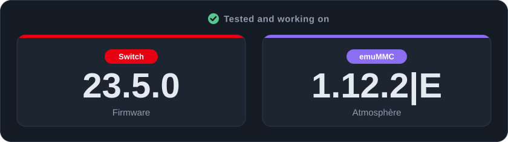
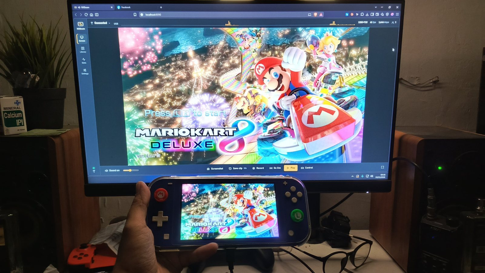
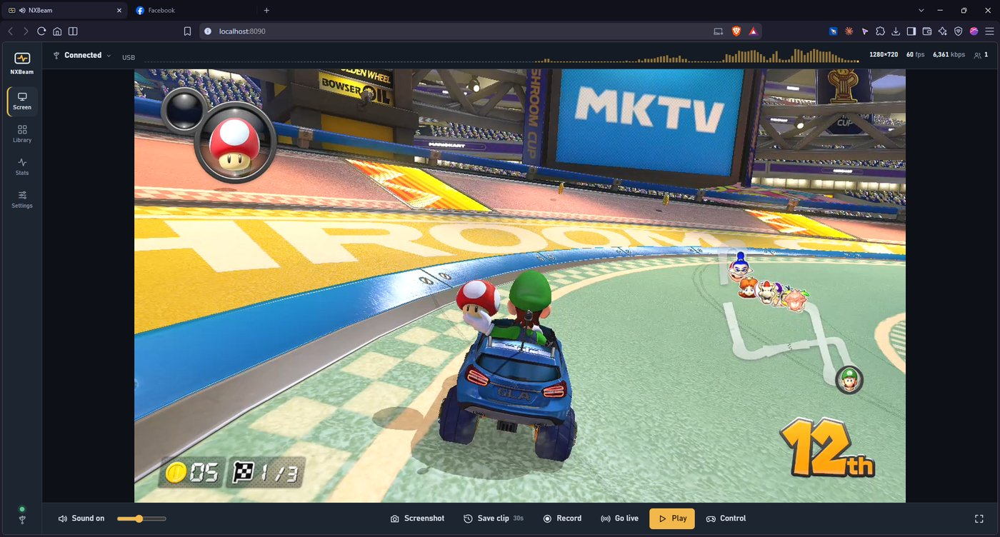
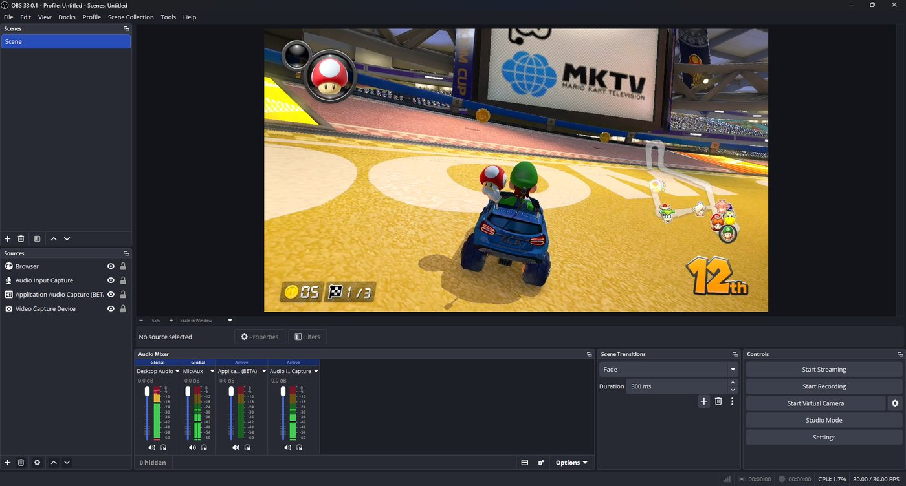

<div align="center">


# NXBeam

### Stream your Nintendo Switch to any browser.
Watch on every device, play from your PC or phone, record, save clips and go live.

<br>



<br>


<br>
<sub>A handheld Switch over USB, streamed to the browser at 1280x720, 61 fps.</sub>

<br>

[](https://github.com/harisratnopambudi/nxbeam/releases/latest)
[](https://github.com/harisratnopambudi/nxbeam/actions/workflows/release.yml)
[](https://github.com/harisratnopambudi/nxbeam/releases)
[](#license)


<br>

**[Download](https://github.com/harisratnopambudi/nxbeam/releases/latest)** &nbsp;&nbsp;|&nbsp;&nbsp; **[Features](#features)** &nbsp;&nbsp;|&nbsp;&nbsp; **[Setup](#setup)** &nbsp;&nbsp;|&nbsp;&nbsp; **[Full guide (Indonesian)](docs/PANDUAN.md)**

</div>

<br>

> [!NOTE]
> Tested on Nintendo Switch firmware **23.5.0** with **Atmosphère 1.12.2|E** (emuMMC). Other versions may work too; if you try one, an issue with the result is welcome.

## Screenshots

<table>
  <tr>
    <td width="50%"></td>
    <td width="50%"></td>
  </tr>
  <tr>
    <td align="center"><sub>Playing over USB: 1280x720, 60 fps</sub></td>
    <td align="center"><sub>Pick Automatic, USB or Network in one click</sub></td>
  </tr>
  <tr>
    <td colspan="2"></td>
  </tr>
  <tr>
    <td colspan="2" align="center"><sub>OBS Studio: <code>http://localhost:8090/overlay</code> as a Browser Source, the game's video and sound only</sub></td>
  </tr>
</table>

## Download

Grab the files from **[Releases](https://github.com/harisratnopambudi/nxbeam/releases/latest)**:

| File | For | How |
|---|---|---|
| **`NXBeam-Switch.zip`** | The Switch SD card | Extract to the **root of the SD card** (`atmosphere`, `NXBeam`, `switch`) and power on. |
| **`NXBeam-PC-Windows.zip`** | The viewer on a Windows PC | Extract and run **`Start NXBeam.bat`**. Portable: Node.js, ffmpeg and USB support are included. |
| `NXBeam-PC-source.zip` | Linux / macOS | Needs Node.js 18+. Run `./start.sh`. |

Then open `http://localhost:8090`. NXBeam finds the Switch by itself. Other devices on the same Wi-Fi can watch too: open the PC's address shown in the NXBeam window, for example `http://192.168.1.10:8090`.

## Features

| | |
|---|---|
| **Many viewers at once** | PC, laptop, phone, tablet, TV. Just a browser, nothing to install. |
| **Play from anywhere** | Gamepad, keyboard or an on-screen touch controller on a phone, with control handover between devices. |
| **Play mode** | One click: sound on, controller taken, fullscreen, a small fps counter. |
| **Frame rate that follows the game** | 60 fps when the game holds it; an even, locked 30 fps when it does not. |
| **Smooth on Wi-Fi** | Adaptive frame pacing and an audio buffer that absorbs bursts and clock drift. |
| **Instant replay** | Save the last 30 seconds as MP4 with one click (or `C`). |
| **Record & go live** | MP4 and RTMP (YouTube, Twitch), as sent by the console or scaled to 1080p60. |
| **OBS** | `http://localhost:8090/overlay`: the game's video and sound only, ready for a Browser Source. |
| **Diagnostics** | Tells you whether frames are lost on the console, on the network or on the PC. |
| **Switch menu** | NXBeam overlay: USB / Network mode, Switch screen off while streaming, restart. |

## Setup

**On the Switch** you need Atmosphère, plus Ultrahand Overlay (or Tesla Menu) for the NXBeam menu. The pack puts this on the SD card:

```
atmosphere/contents/0100000000000C20/   streaming sysmodule (no UI)
atmosphere/contents/0100000000000C21/   its boot launcher
NXBeam/console-settings/config.ini      settings
switch/.overlays/nxbeam.ovl             NXBeam menu in the overlay
```

Open the overlay (**ZL + ZR + D-pad Down**), pick **NXBeam**, choose **USB mode** or **Network mode**, toggle **Screen off while streaming**, then **Restart Switch**.

- **Network**: works docked or handheld; NXBeam finds the console on its own.
- **USB**: handheld only (the dock uses the port). On Windows it needs the WinUSB driver once, see below.

### USB driver on Windows (once)

1. Put the Switch in **USB mode** from the NXBeam overlay and restart it, then plug the USB-C cable in (handheld).
2. Download and open **[Zadig](https://zadig.akeo.ie/)**.
3. Menu **Options > List All Devices**.
4. In the device list, pick the one whose **USB ID is `1209` `5F1E`**.
5. Set the target driver (right of the green arrow) to **WinUSB**.
6. Click **Install Driver** (or **Reinstall Driver**) and wait for it to finish.

<sub>Pick only the device that reads <b>1209 5F1E</b>: installing WinUSB on another device (a mouse, a keyboard) stops it from working.</sub>

If NXBeam still does not see the Switch, use **Check USB devices** on its connection screen: it lists what the PC sees and says what is missing.


The full guide (USB, 1080p60, OBS, live streaming, smoothness tips) is in **[docs/PANDUAN.md](docs/PANDUAN.md)** (Indonesian).

## Build

- Every push to `main` builds and publishes a release from the version in `package.json` (GitHub Actions: Windows portable build, the Switch overlay in `devkitpro/devkita64`, and the SD pack).
- The Switch overlay lives in [`overlay/`](overlay).
- From source: `npm install && npm start`. Without a console: `npm run simulate`. Tests: `npm test`.

## License

- **NXBeam PC app**: MIT, Haris DevLab.
- **Streaming sysmodule** in `switch-pack/`: [Switch Frame Tap](https://github.com/TomasUribe/switch-frame-tap) by Tomas Uribe, **GPL-2.0**. The only change is the folder names inside the program (see `switch-pack/NXBeam/lisensi/PERUBAHAN.txt` and `tools/make-switch-pack.py`).
- **Sound patches**: [dvr-patches](https://github.com/exelix11/dvr-patches) by exelix11, BSD-3-Clause.
- **Switch overlay** (`overlay/`): GPL-2.0, built on libtesla by WerWolv.

<div align="center">
<br>
<sub>Made by <b>Haris DevLab</b> (harisdevlab.online)</sub>
</div>
