<div align="center">


# NXBeam

### Stream your Nintendo Switch to any browser.
Mirror the whole console, HOME menu included, to any browser or the Android app on phones and TVs; play from your PC or phone, record, save clips and go live.

<br>

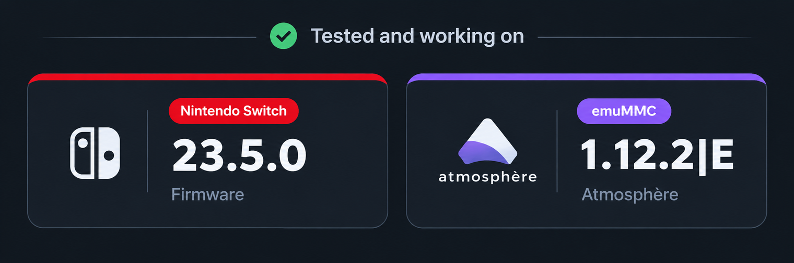

<br>


<br>
<sub>A handheld Switch over USB, streamed to the browser at 1280x720, 61 fps.</sub>

<br>

[](https://github.com/harisratnopambudi/nxbeam/releases/latest)
[](https://github.com/harisratnopambudi/nxbeam/actions/workflows/release.yml)
[](https://github.com/harisratnopambudi/nxbeam/releases)
[](#license)


<a href="https://saweria.co/harisratnopambudi"></a>

<br>

**[Download](https://github.com/harisratnopambudi/nxbeam/releases/latest)** &nbsp;&nbsp;|&nbsp;&nbsp; **[Features](#features)** &nbsp;&nbsp;|&nbsp;&nbsp; **[Android app](#android-app-phones-and-tvs)** &nbsp;&nbsp;|&nbsp;&nbsp; **[Setup](#setup)** &nbsp;&nbsp;|&nbsp;&nbsp; **[Full guide (Indonesian)](docs/PANDUAN.md)**

</div>

<br>

> [!NOTE]
> Tested on Nintendo Switch firmware **23.5.0** with **Atmosphère 1.12.2|E** (emuMMC). Other versions may work too; if you try one, an issue with the result is welcome.

<a name="screenshots"></a>
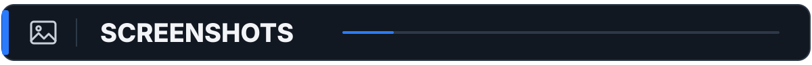

<table>
  <tr>
    <td width="50%"></td>
    <td width="50%">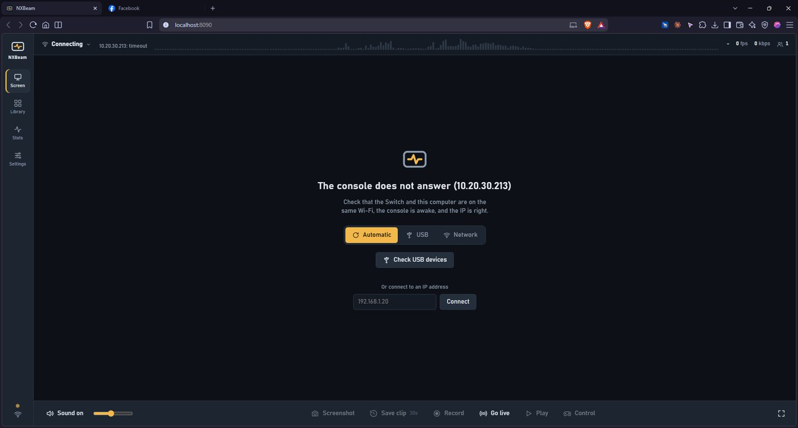</td>
  </tr>
  <tr>
    <td align="center"><sub>Playing over USB: 1280x720, 60 fps</sub></td>
    <td align="center"><sub>Pick Automatic, USB or Network in one click</sub></td>
  </tr>
  <tr>
    <td colspan="2"></td>
  </tr>
  <tr>
    <td colspan="2" align="center"><sub>OBS Studio: <code>http://localhost:8090/overlay</code> as a Browser Source, the game's video and sound only</sub></td>
  </tr>
  <tr>
    <td colspan="2">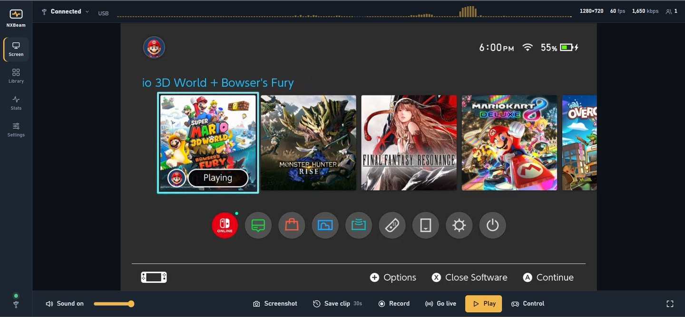</td>
  </tr>
  <tr>
    <td colspan="2" align="center"><sub>Full mirroring (beta): the HOME menu and every app, not only games, over USB at 60 fps</sub></td>
  </tr>
</table>

<a name="download"></a>
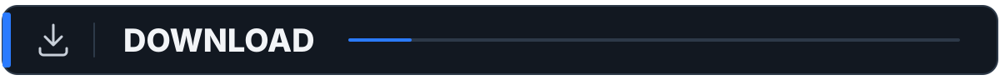

Grab the files from **[Releases](https://github.com/harisratnopambudi/nxbeam/releases/latest)**:

| File | For | How |
|---|---|---|
| **`NXBeam-Switch.zip`** | The Switch SD card | Extract to the **root of the SD card** (`atmosphere`, `NXBeam`, `switch`) and power on. |
| **`NXBeam-Setup.exe`** | **Windows 10 / 11 (recommended)** | Run it. NXBeam installs for your user (no administrator), with its own window, a tray icon, online updates, and the **USB driver for the Switch, installed right away: no Zadig, no need to plug the Switch in first**. See [Windows app](#windows-app). |
| `NXBeam-PC-Windows.zip` | Windows, portable | Extract and run **`NXBeam.exe`** (or `Start NXBeam.bat` for the browser). Node.js, ffmpeg and USB support are included. |
| **`NXBeam-PC-macOS-AppleSilicon.zip`** | Mac with M1 / M2 / M3 / M4 | Extract, then **right-click `Start NXBeam.command` > Open** (only the first time; after that a double-click is enough). Portable like the Windows build. |
| **`NXBeam-PC-macOS-Intel.zip`** | Mac with an Intel CPU | Same as above. |
| **`NXBeam-Android.apk`** | Android phones, tablets and Android TV / Google TV (Android 8+) | Install the APK. Connects to the Switch on its own, no PC needed. See [Android app](#android-app-phones-and-tvs). |
| `NXBeam-PC-source.zip` | Linux | Needs Node.js 18+. Run `./start.sh`. |

On a Mac the first start may say the app is from an unidentified developer: right-click > **Open**, or allow it in **System Settings > Privacy & Security > Open Anyway**. USB needs no driver on macOS.

<a name="windows-app"></a>
### Windows app

`NXBeam-Setup.exe` installs NXBeam as a Windows app:

- **Its own window**, not a browser tab. It runs on WebView2, the Edge engine in Windows, set up for streaming:
  - the GPU is used even where a browser would refuse it, and the fast GPU on laptops with two, so frame generation stays available;
  - drawing does not slow down when the window is in the background or covered (for OBS window capture);
  - sound plays at once, with no click first.
- **F11**: full screen.
- **Tray icon**: closing the window keeps NXBeam running for phones, TVs and OBS. Right-click the icon for Open, Open in browser, Install USB driver, Start with Windows, and Exit.
- **USB driver**: the installer installs WinUSB for the Switch (USB ID `1209` `5F1E`, named **NXBeam**). Windows asks for permission once. The Switch does not need to be plugged in: the driver waits in Windows' driver store and is used the first time the Switch connects in USB mode. It is the same engine as Zadig (libwdi).
  - To install it again later: Start menu > **NXBeam - Install USB driver**, or the tray icon.
- **Online updates** work as in the portable build. The app replaces itself and restarts.
- Windows may show **"Windows protected your PC"** for the installer, because it is not code-signed. Click **More info > Run anyway**.

Then open `http://localhost:8090` (the Windows app opens it in its own window). NXBeam finds the Switch by itself. Other devices on the same Wi-Fi can watch too: open the PC's address shown in the NXBeam window, for example `http://192.168.1.10:8090`.

### Online updates

> [!TIP]
> **Use 1.18.2 or newer.** It updates itself: when a new release is out, NXBeam tells you and installs it with one click. Older versions have to be replaced by hand once. Download the latest files above, then you never have to do it again.

Nothing changes until you confirm.

**PC.** A bar appears at the top of NXBeam when a new version is out. **Update** downloads it, checks its checksum and restarts NXBeam. The **x** hides the bar until the next version.

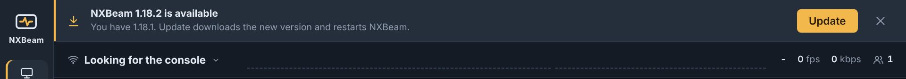

The bar is easy to miss while you play, so **Settings** also gets a dot, and **Settings > Version & updates** always shows the installed and the latest version, with **Update** and **Check for updates**.

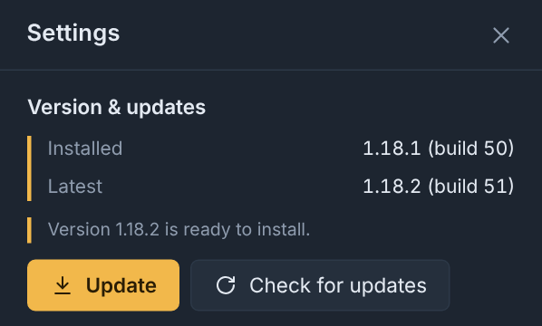

Start NXBeam with its launcher (`Start NXBeam.bat`, `Start NXBeam.command` or `start.sh`): the launcher is what installs the update. Your settings, recordings and screenshots are kept.

| Where | How |
|---|---|
| **PC** (Windows, Mac, Linux) | The bar above, or **Settings > Version & updates**. |
| **Android** | A card on the home screen. **Update** downloads the APK; Android asks you to install it. |
| **Switch** | Open **NXBeam Update** from the homebrew menu. It shows the installed and the latest version and updates the SD card files, keeping your settings, then restarts the Switch. |

**Switch.** NXBeam Update downloads the release, checks its checksum, replaces the NXBeam files on the SD card (your `config.ini` stays) and offers to restart.

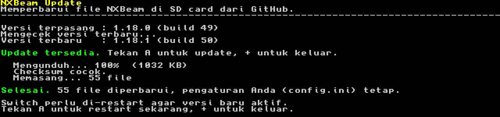

<a name="features"></a>
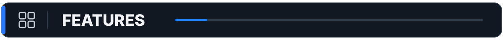

| | |
|---|---|
| **Many viewers at once** | PC, laptop, phone, tablet, TV. Just a browser, nothing to install. |
| **Play from anywhere** | Gamepad, keyboard or an on-screen touch controller on a phone, with control handover between devices. |
| **Play mode** | One click: sound on, controller taken, fullscreen, a small fps counter. |
| **Frame rate that follows the game** | 60 fps when the game holds it; an even, locked 30 fps when it does not. |
| **Smooth on Wi-Fi** | Adaptive frame pacing and an audio buffer that absorbs bursts and clock drift. |
| **Frame generation** (beta) | Inserts a generated frame between every two real ones, so a 30 fps game shows at 60 on a 60 Hz screen (or 60 at 120 on a high-refresh screen). Motion is estimated on the GPU; adds about half a frame of delay. Off by default: **Settings > Picture**. |
| **Veyra** (Windows) | One click (the sparkle button, or **Settings > Picture**) opens the Switch's own stream in [Veyra](https://github.com/Likely7/Veyra-NRVideo), which plays it with its GPU frame generation, super resolution and denoising (DLSS / FSR / XeSS backends, NVIDIA or AMD). NXBeam serves the untouched stream at `http://127.0.0.1:8090/live.mkv` and asks a running Veyra to open it; you can also paste that address into Veyra's network address dialog. |
| **Instant replay** | Save the last 30 seconds as MP4 with one click (or `C`). |
| **Record & go live** | MP4 and RTMP (YouTube, Twitch), as sent by the console or scaled to 1080p60. |
| **OBS** | `http://localhost:8090/overlay`: the game's video and sound only, ready for a Browser Source. |
| **Diagnostics** | Tells you whether frames are lost on the console, on the network or on the PC. |
| **Android app** | Phones and Android TV: straight to the Switch over Wi-Fi or USB OTG, no PC. Records MP4 and takes screenshots to the gallery. |
| **Switch menu** | NXBeam overlay: USB / Network mode, restart. |
| **Full mirroring** (beta) | Everything on the console streams: the HOME menu, system settings, the Album and every app, not only games. Turn on **HOME menu** (and **System overlays** for the volume bar and menus) in the overlay; both are off by default because they can slow the HOME button in some games. Tested on FW 23.5.0. |
| **Online updates** | PC, Android and Switch check the latest release and update with one confirmation. On the PC: a bar at the top and **Settings > Version & updates**. |
| **Switch screen off** | Turn the console's screen off while it streams (saves battery when you play on the PC), one toggle in the overlay. |

<a name="android-app-phones-and-tvs"></a>
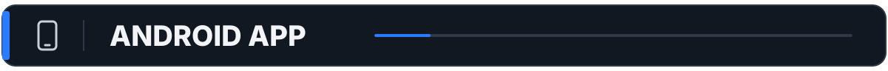

One APK for phones, tablets and Android TV / Google TV boxes. It talks to the Switch by itself, so no PC is needed.

<table>
  <tr>
    <td width="34%">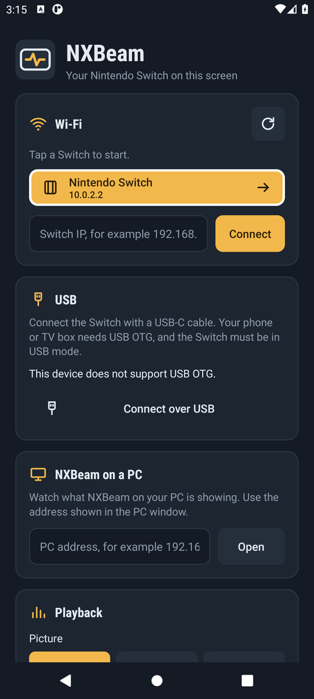</td>
    <td width="66%">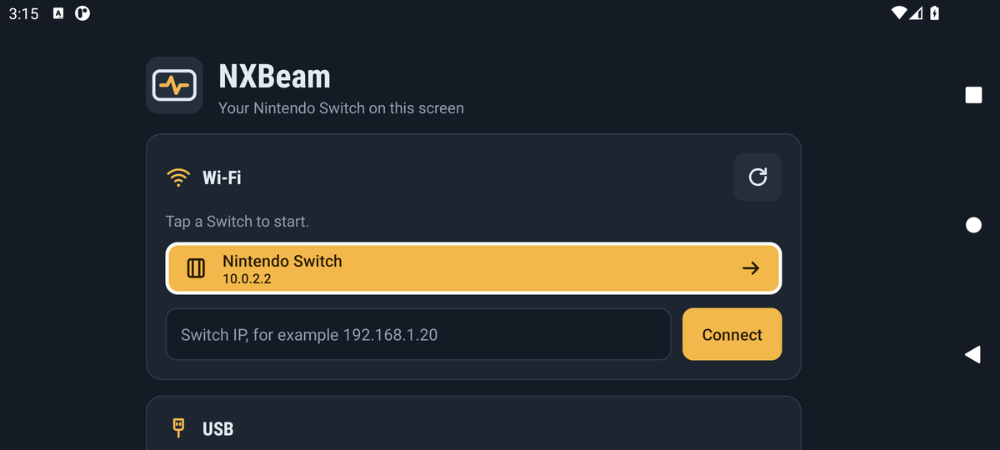</td>
  </tr>
  <tr>
    <td align="center"><sub>Phone: the Switch is found on Wi-Fi</sub></td>
    <td align="center"><sub>On a wide screen such as a TV, the same app in one centered column</sub></td>
  </tr>
</table>

| Way to connect | How |
|---|---|
| **Wi-Fi** | Switch in **Network** mode, same Wi-Fi. The app finds it; tap it. Or type its IP. |
| **USB OTG** | Switch in **USB** mode, handheld. Connect with an **OTG adapter (USB-C male to USB-A female) on the phone plus a USB-A to USB-C cable** to the Switch, the same cable you would use on a PC. Android asks to open NXBeam when the Switch is plugged in. |
| **NXBeam on a PC** | Type the PC address shown in the NXBeam window, for example `192.168.1.10:8090`. Watches what the PC is showing. Use this while the PC is connected: the Switch serves one viewer at a time. |

> [!IMPORTANT]
> **A USB-C to USB-C cable does not work.** The Switch keeps the host role (or just charges the phone), so the phone never sees it, and the "USB controlled by: This device" switch on Samsung and other phones fails because the Switch refuses the role swap. The USB-A end of an OTG adapter makes the phone the host from the start. **Check USB** in the app shows what the phone sees.

- **Picture**: *Fastest* shows each frame the moment it arrives; *Balanced* and *Smoothest* wait a few frames to keep motion even on busy Wi-Fi.
- **Record** saves MP4 (the console's H.264 untouched, sound in AAC) to **Movies/NXBeam**; **Screenshot** goes to **Pictures/NXBeam**.
- **Controller**: turn on *Use a controller on the Switch* and a controller paired to the phone or TV plays the Switch (buttons by position, so the bottom button is B).
- **On a TV**: everything works with the remote. Press OK to show the player controls.
- **Installing**: on a phone, open the APK and allow installs from that app when asked. On Android TV, install it with a file manager or the Downloader app, or copy it over with a USB stick.

<a name="setup"></a>
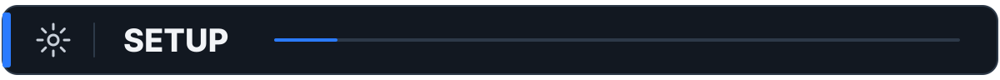

**On the Switch** you need Atmosphère, plus Ultrahand Overlay (or Tesla Menu) for the NXBeam menu. The pack puts this on the SD card:

```
atmosphere/contents/0100000000000C20/   streaming sysmodule (no UI)
atmosphere/contents/0100000000000C21/   its boot launcher
NXBeam/console-settings/config.ini      settings
switch/.overlays/nxbeam.ovl             NXBeam menu in the overlay
```

Open the overlay with your overlay combo and pick **NXBeam**. The combo depends on your setup: Ultrahand's default is **ZL + ZR + D-pad Down**, Tesla's is **L + D-pad Down + R3** (right stick pressed), and either can be changed in the overlay's settings.

<table>
  <tr>
    <td width="50%">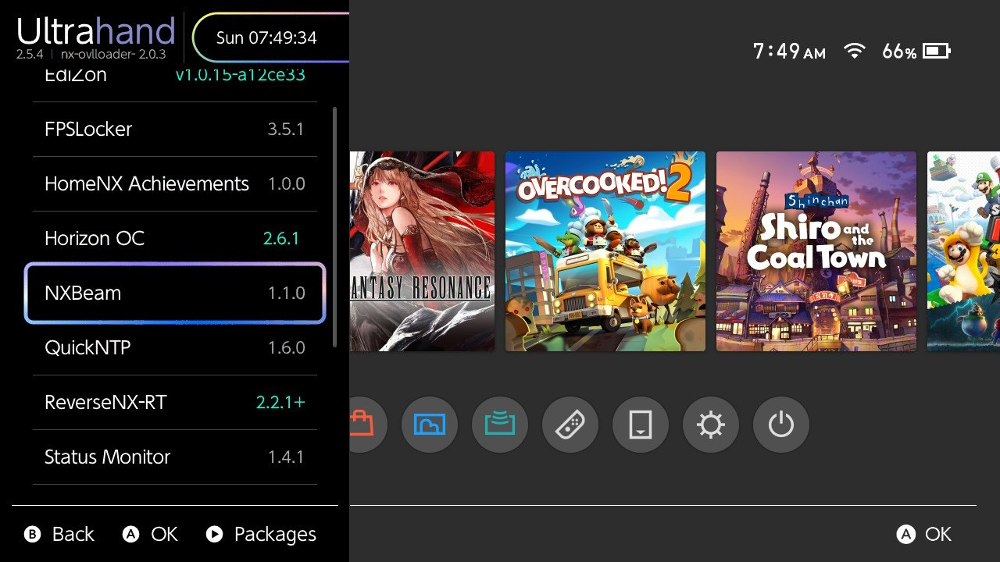</td>
    <td width="50%">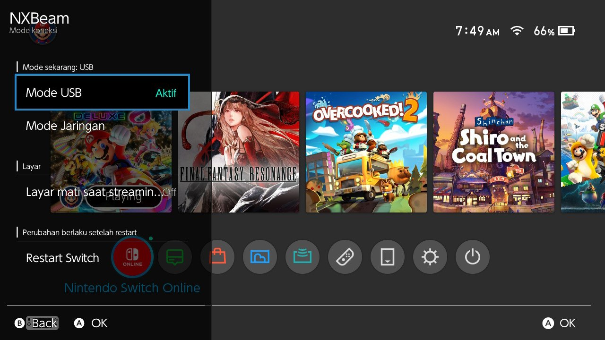</td>
  </tr>
  <tr>
    <td align="center"><sub>NXBeam in the Ultrahand overlay list</sub></td>
    <td align="center"><sub>The NXBeam menu: connection mode, screen off, restart</sub></td>
  </tr>
</table>

| Menu item | What it does |
|---|---|
| **USB mode** / **Network mode** | How the Switch connects to NXBeam: USB cable or network. |
| **Switch IP** | The console's address on the network. Type it in NXBeam if it does not find the Switch by itself. |
| **Resolution** | **1080p** or **720p (smoothest)**, the most the console sends. Applies at once, no restart: the stream pauses for a moment and comes back at the new size. 720p keeps a steadier 60 fps. |
| **Game display** (ReverseNX-RT) | Needs [SaltyNX](https://github.com/masagrator/SaltyNX). **Mode**: Auto, **Docked** or **Handheld** for the running game, live: a handheld Switch can run the game as docked, at its docked (1080p) resolution, which NXBeam then streams. **Docked / Handheld resolution**: the game's default display resolution (480p to 1080p), for games that ask for it. Saved per game, in the same file ReverseNX-RT uses. Built in from [ReverseNX-RT](https://github.com/masagrator/ReverseNX-RT) by masagrator (MIT). |
| **Screen off while streaming** | **On**: the Switch screen goes dark while a stream runs (saves battery; play on the PC). Applies at once. |
| **HOME menu** (beta, off by default) | **On**: the HOME menu, the Album and system screens stream too, not only games. In some games it makes the HOME button slow to respond, so it is off unless you turn it on. |
| **System overlays** (beta, off by default) | **On**: the volume bar, quick settings, power menu and Tesla / Ultrahand menus appear in the stream. |
| **Restart Switch** | Applies the changes. |
| **NXBeam sysmodule** | **Running**: switch NXBeam on or off now, no restart. **Start at boot**: whether it starts with the Switch. (These replace the sysmodules menu of Ultrahand for NXBeam: switching it on there would start the module too early at boot.) |
| **About** | The installed NXBeam version. When a newer release is out, the menu says so at the top (**Update available**) and under the title: open the **NXBeam Update** app to install it. The check runs in the background at most every 6 hours, only with internet. Made by Haris DevLab. |

- **Network**: works docked or handheld; NXBeam finds the console on its own.
- **USB**: handheld only (the dock uses the port). On Windows it needs the WinUSB driver once, see below.

### USB driver on Windows (once)

**With the installer (`NXBeam-Setup.exe`) this is already done.** The steps below are for the portable zip, or if the automatic install did not work.

1. Put the Switch in **USB mode** from the NXBeam overlay and restart it, then plug the USB-C cable in (handheld).
2. Download and open **[Zadig](https://zadig.akeo.ie/)**.
3. Click **Options**, then **List All Devices**, so the Switch shows up in the list.
4. In the device list, pick **NXBeam** (its **USB ID is `1209` `5F1E`**). With a Switch pack older than v1.15 it is called **Switch Frame Tap**.
5. Set the target driver (right of the green arrow) to **WinUSB**.
6. Click **Install Driver** (or **Reinstall Driver**) and wait for it to finish.

<p align="center">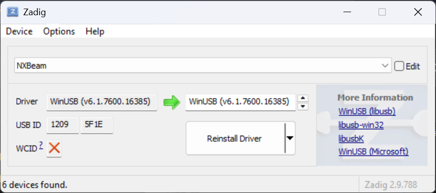</p>

<sub>Pick only the device that reads <b>1209 5F1E</b>: installing WinUSB on another device (a mouse, a keyboard) stops it from working.</sub>

If NXBeam still does not see the Switch, use **Check USB devices** on its connection screen: it lists what the PC sees and says what is missing.


The full guide (USB, 1080p60, OBS, live streaming, smoothness tips) is in **[docs/PANDUAN.md](docs/PANDUAN.md)** (Indonesian).

<a name="build"></a>
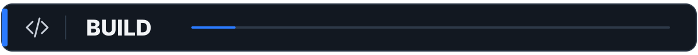

- Every push to `main` builds and publishes a release from the version in `package.json` (GitHub Actions: the Windows app, installer and portable build, the Switch overlay in `devkitpro/devkita64`, and the SD pack).
- The Switch overlay lives in [`overlay/`](overlay).
- From source: `npm install && npm start`. Without a console: `npm run simulate`. Tests: `npm test`.

<a name="license"></a>
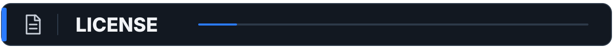

- **NXBeam PC app**: MIT, Haris DevLab.
- **Streaming sysmodule** in `switch-pack/`: [Switch Frame Tap](https://github.com/TomasUribe/switch-frame-tap) by Tomas Uribe, **GPL-2.0**. The only changes are the folder names, the USB device name and the notice title inside the program (see `switch-pack/NXBeam/lisensi/PERUBAHAN.txt` and `tools/make-switch-pack.py`).
- **Sound patches**: [dvr-patches](https://github.com/exelix11/dvr-patches) by exelix11, BSD-3-Clause.
- **Switch overlay** (`overlay/`): GPL-2.0, built on libtesla by WerWolv.

<a name="support"></a>
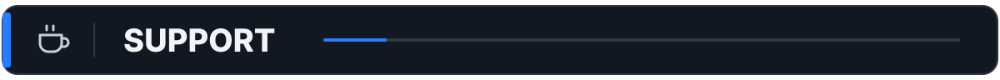

NXBeam is free. If it helps you, a tip keeps it going:

<a href="https://saweria.co/harisratnopambudi"></a>

<div align="center">
<br>
<sub>Made by <b>Haris DevLab</b> (harisdevlab.online)</sub>
</div>
